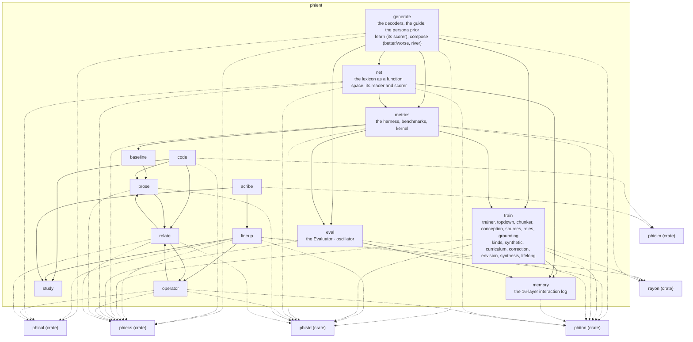

# phient — architecture

## The modules and what they use

## Modules, one diagram each

- [baseline](../../docs/phient/baseline.md)
- [code](../../docs/phient/code.md)
- [eval](../../docs/phient/eval.md)
- generate: [generate](../../docs/phient/generate.md) · [learn](../../docs/phient/learn.md) · [compose](../../docs/phient/compose.md)
- [lineup](../../docs/phient/lineup.md)
- [memory](../../docs/phient/memory.md)
- [metrics](../../docs/phient/metrics.md) · [nonlinear](../../docs/phient/nonlinear.md) · [data](../../docs/phient/data.md)
- [net](../../docs/phient/net.md)
- [operator](../../docs/phient/operator.md)
- [prose](../../docs/phient/prose.md)
- [relate](../../docs/phient/relate.md)
- [scribe](../../docs/phient/scribe.md)
- [study](../../docs/phient/study.md)
- train: [kinds](../../docs/phient/kinds.md) · [synthetic](../../docs/phient/synthetic.md) · [curriculum](../../docs/phient/curriculum.md) · [correction](../../docs/phient/correction.md) · [envision](../../docs/phient/envision.md) · [synthesis](../../docs/phient/synthesis.md) · [lifelong](../../docs/phient/lifelong.md) · [trainer](../../docs/phient/trainer.md) · [topdown](../../docs/phient/topdown.md) · [chunker](../../docs/phient/chunker.md) · [conception](../../docs/phient/conception.md) · [sources](../../docs/phient/sources.md) · [roles](../../docs/phient/roles.md) · grounding ([docs/phiano/core.md](../../docs/phiano/core.md))

What is left to do: [TODO.md](TODO.md)
