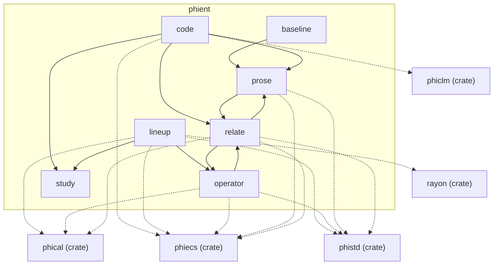

# phient — architecture

## The modules and what they use

## Modules, one diagram each

- [baseline](../../docs/phient/baseline.md)
- [code](../../docs/phient/code.md)
- [lineup](../../docs/phient/lineup.md)
- [operator](../../docs/phient/operator.md)
- [prose](../../docs/phient/prose.md)
- [relate](../../docs/phient/relate.md)
- [study](../../docs/phient/study.md)

What is left to do: [TODO.md](TODO.md)
